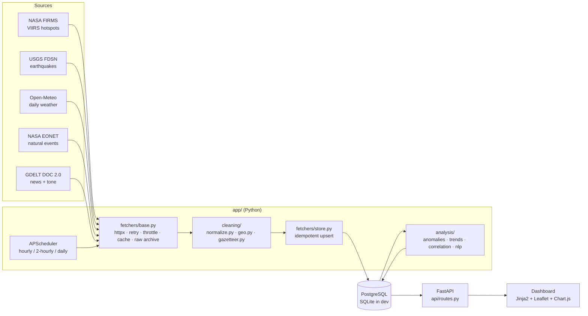

# SAMVEDNA

**Situational Awareness & Monitoring of Vulnerabilities, Events, Disasters & News Analytics**

SAMVEDNA is a web app that collects live open-source data on fires, earthquakes, extreme weather and natural events across ten states of southern and western India, together with Indian news coverage of those hazards. It cleans and stores the data, flags unusual activity with explainable statistics, and shows everything on an interactive dashboard with alerts. The aim is to support Humanitarian Assistance & Disaster Relief (HADR) planning.

It is an independent student project and is not affiliated with any government body.


## Features

- **Five live data sources:** NASA FIRMS, USGS, Open-Meteo, NASA EONET and GDELT. All fetches are rate-limited and retried, responses are cached, and each raw response is archived.
- **Cleaning rules in code, with tests:** IST timestamps, bbox and state polygon filters, cross-satellite fire de-duplication, near-duplicate headline removal, and an off-topic headline filter. Rejected rows are counted per reason.
- **Anomaly alerts:** a 30-day rolling z-score for every state × metric, STL seasonal residuals for temperature, and a same-season baseline for fires. Each alert has a plain-English message, e.g. *"Fire hotspots in Karnataka (Suomi-NPP): 32 on 14 Oct vs 4/day at this time last year (z = 6.2)"*.
- **Statistics:** Mann-Kendall trend tests with Sen's slope, lagged Spearman correlation between hazards and news volume, and a year-over-year seasonal comparison.
- **NLP:** TF-IDF keywords overall and per week, NMF topic clusters with example headlines, GDELT tone plus VADER headline sentiment, and gazetteer-based state geotagging.
- **Dashboard:**
  - Leaflet map with a fire heatmap, quake circles and EONET clusters; click a state to filter the whole dashboard.
  - KPI cards, alert feed, and Chart.js time series with a rolling band and anomaly points.
  - News, statistics and data-health tabs, plus CSV export.
  - Dark/light theme; responsive layout.
- **API:** FastAPI with auto-generated OpenAPI docs at **`/docs`**.

## Architecture



## Quick start

### Option A: Docker (PostgreSQL, one command)

```bash
cp .env.example .env          # optionally add FIRMS_MAP_KEY
docker compose up --build
```

Open http://localhost:8000. On first boot, the container runs migrations and starts a backfill of every source in the background. The scheduler then keeps the data fresh. The backfill covers 90 days, plus 5 years of weather, 10 years of quakes and the 2025 FIRMS archive. GDELT throttling makes the full backfill take 10–60 min.

### Option B: Local Python (SQLite)

```bash
python3.12 -m venv .venv && source .venv/bin/activate
pip install -r requirements.txt
cp .env.example .env
alembic upgrade head
python -m scripts.backfill            # all sources; add --only gdelt etc. for one
python -m scripts.run_analysis        # recompute alerts / stats / NLP (backfill does this too)
uvicorn app.main:app --reload         # http://localhost:8000
pytest -q                             # tests
```

### Configuration

All settings live in `app/config.py` and can be overridden through environment variables or `.env`:

| Setting | Default | Notes |
|---|---|---|
| `DATABASE_URL` | `sqlite:///samvedna.db` | `postgresql+psycopg://…` in Docker/Render |
| `FIRMS_MAP_KEY` | empty | Free key from [FIRMS](https://firms.modaps.eosdis.nasa.gov/api/map_key/). Without it, only the last 7 days of NRT fires (public CSV) are available. |
| `STATES` | 10 states | JSON list, e.g. `'["Kerala","Goa"]'`. Names must match geoBoundaries (diacritics ignored). |
| `BBOX` | `[68,6,85,27]` | west, south, east, north |
| `ANOMALY_WINDOW_DAYS`, `Z_MEDIUM`, `Z_HIGH` | 30, 2, 3 | z-score rule |
| `ENABLE_SCHEDULER` | true | set `false` when running scripts alongside the server |

## Data sources and licences

| Source | What we use | Licence / terms |
|---|---|---|
| [NASA FIRMS](https://firms.modaps.eosdis.nasa.gov/) | VIIRS NOAA-20 & Suomi-NPP active fires (NRT area API or public 7-day CSV), Suomi-NPP yearly India archive | NASA open data policy; acknowledge "NASA FIRMS". |
| [USGS FDSN Event](https://earthquake.usgs.gov/fdsnws/event/1/) | Earthquakes M ≥ 2.5 in the bbox | US public domain |
| [Open-Meteo](https://open-meteo.com/) | Daily rainfall, Tmax, Tmin and wind at each state capital (ERA5 archive + forecast) | CC BY 4.0; free non-commercial API |
| [NASA EONET v3](https://eonet.gsfc.nasa.gov/) | Curated natural events | NASA open data |
| [GDELT DOC 2.0](https://blog.gdeltproject.org/gdelt-doc-2-0-api-debuts/) | Article lists and daily volume/tone timelines for four hazard queries (`sourcecountry:IN`) | Free, unrestricted use with attribution to the GDELT Project |
| [geoBoundaries](https://www.geoboundaries.org/) gbOpen IND ADM1 (`data/geo/`) | State polygons for point-in-polygon tagging | **CC BY 2.5 IN** (source: DataMeet India community, Election Commission of India). Boundaries are illustrative only. |
| [OpenStreetMap](https://www.openstreetmap.org/copyright) | Map tiles | ODbL; tile usage policy (light use, attribution) |

**Collection ethics:**
- Only public, non-personal data is collected, with no social-media scraping.
- Every request carries a descriptive `User-Agent`.
- Hosts are throttled: GDELT requests are ≥ 6 s apart, and the gap doubles after any HTTP 429.
- Responses are cached for 1 h (closed historical windows for 24 h).
- Raw responses are archived under `data/raw/` for audit.

## Project layout

```
app/
  config.py         settings (region, thresholds, schedule)
  db.py, models.py  SQLAlchemy engine/session + 9 tables
  fetchers/         base.py (HTTP plumbing), store.py (upsert), one module per source
  cleaning/         normalize.py (rules R1–R9), geo.py (state tagging), gazetteer.py
  analysis/         series.py, anomalies.py, trends.py, correlation.py, nlp.py
  api/routes.py     JSON endpoints
  scheduler.py      APScheduler jobs
  templates/, static/  dashboard UI
scripts/            backfill.py, run_analysis.py, entrypoint.sh
migrations/         Alembic
tests/              cleaning, analysis, API, empty-database tests
report/report.md    technical report
```

## API

| Endpoint | Purpose |
|---|---|
| `GET /api/summary?state=&days=` | KPI counts, active alerts, last update per source |
| `GET /api/map?layer=fires\|quakes\|events\|states&days=&state=` | GeoJSON |
| `GET /api/timeseries?metric=&state=&days=` | series + rolling mean/std + z + flags |
| `GET /api/alerts?severity=&state=&days=` | alerts, most severe first |
| `GET /api/trends`, `/api/correlation`, `/api/seasonal` | statistics results |
| `GET /api/news?hazard=&state=&days=` | headlines, keywords, topics, tone, coverage-vs-hazard series |
| `GET /api/health` | per-source fetch status and rejection reasons |
| `GET /api/export?table=&format=csv&days=` | CSV download |
| `GET /docs` | interactive OpenAPI docs |

## Deployment (Render)

`render.yaml` is a Render Blueprint that sets up a Docker web service and a free managed PostgreSQL database:

1. Push this repo to GitHub.
2. In Render, go to **New → Blueprint** and select the repo.
3. Optionally set `FIRMS_MAP_KEY` in the service's environment.

On first boot the service migrates and backfills the database by itself.

Free-tier caveats:
- Free web services sleep after 15 minutes without traffic, and the in-process scheduler sleeps with them. Data refreshes on the next wake-up.
- Free Postgres instances expire after 30 days.

## Screenshots

| | |
|---|---|
|  |  |
|  |  |
|  |  |

## Limitations

- **GDELT window:** the DOC API covers about the last 3 months and throttles aggressively, so news history is short and backfills are slow.
- **Fires without a key:** without `FIRMS_MAP_KEY` only the last 7 days of near-real-time fires can be fetched. 2025 comes from the yearly archive, and Jan–Oct 2026 is a gap.
- **Satellite revisits:** VIIRS passes over twice a day per satellite. Cloud and smoke hide fires, and small or short fires are missed.
- **Weather points:** one point per state (the capital) is a crude proxy for statewide rainfall or heat.
- **News geotagging:** a headline is tagged to a state only when it names the state or a listed city. District- or village-only headlines are missed, and shared names can mis-tag.
- **Earthquake coverage:** the USGS global catalogue is incomplete below about M4 in peninsular India. National networks such as NCS would be denser but have no open API.

See `report/report.md` for methods, findings and future work, and `DECISIONS.md` for design choices.
