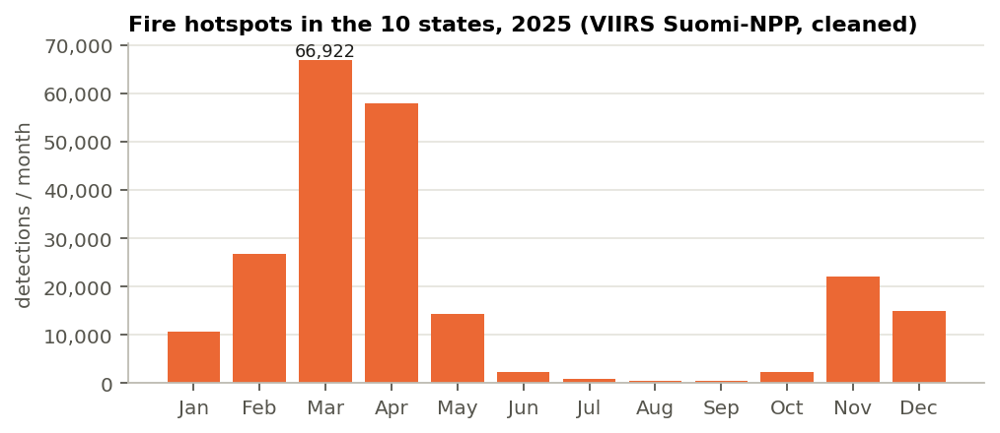
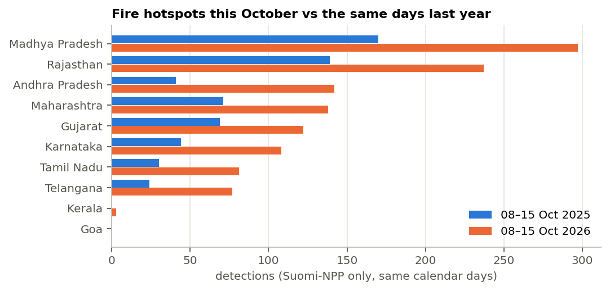
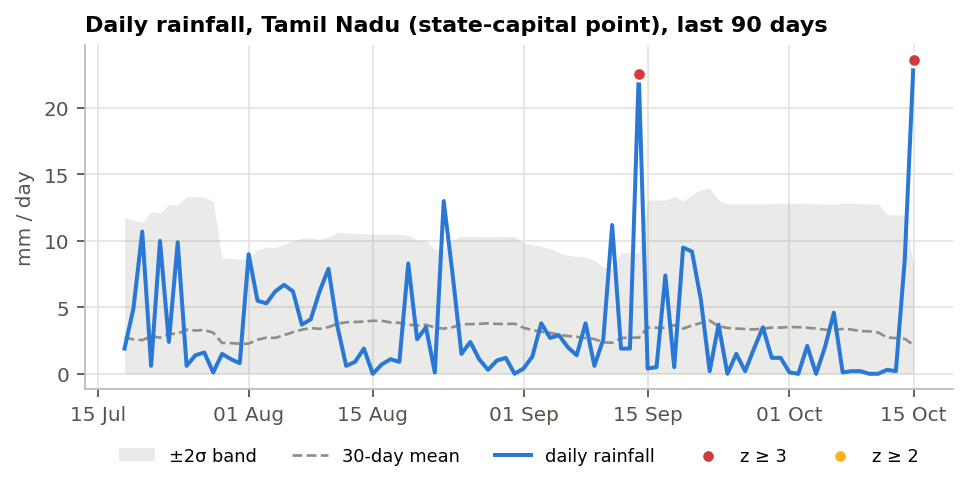

# SAMVEDNA: Technical Report

*Situational Awareness & Monitoring of Vulnerabilities, Events, Disasters & News Analytics.*
Independent student project. Data in this report was collected on 15 October 2026.

## 1. Problem

Disaster-relief planners need one place that answers three questions each morning: **what is happening now, is it unusual, and is anyone talking about it?** The raw answers already exist in open data. Satellites detect active fires, seismic networks log earthquakes, reanalysis gives daily weather, and global news is indexed within hours. But each source has its own format, time zone, error modes and access rules.

SAMVEDNA collects five such sources for ten states (Maharashtra, Gujarat, Goa, Karnataka, Kerala, Tamil Nadu, Andhra Pradesh, Telangana, Rajasthan, Madhya Pradesh). It then:
- cleans the data and tags every record to a state;
- stores it in PostgreSQL;
- runs transparent statistics to flag unusual activity;
- presents the results on a web dashboard with plain-English alerts.

The design goal throughout was **explainability**: every alert can be traced to a number, a baseline and a rule.

## 2. Data sources and legality

| Source | Content | Access | Volume collected |
|---|---|---|---|
| NASA FIRMS | VIIRS active-fire detections (NOAA-20, Suomi-NPP), near real time | Area API with free MAP_KEY; public 7-day CSV without a key | 2,733 hotspots, 8–15 Oct 2026 |
| NASA FIRMS archive | Suomi-NPP yearly India file (standard processing) | Public download | 220,393 hotspots, 1 Jan–31 Dec 2025 |
| USGS FDSN | Earthquakes M ≥ 2.5 | Open API, no key | 35 events, Jun 2017–Oct 2026 |
| Open-Meteo | Daily rainfall, Tmax, Tmin, wind (ERA5 archive + forecast) at each state capital | Open API, no key | 18,630 state-days, Sep 2021–Oct 2026 (+7-day forecast) |
| NASA EONET v3 | Curated natural events (wildfires, floods, storms) | Open API, no key | 54 event-points (wildfires, floods, storms) |
| GDELT DOC 2.0 | Indian-source news articles and daily volume/tone timelines for four hazard queries | Open API, no key, ≤ 1 request / 5 s | see §7.5 |
| geoBoundaries IND ADM1 | State polygons | CC BY 2.5 IN | 36 polygons, 10 used |

**Legality and ethics.**
- Every source is publicly accessible and free to reuse with attribution, and every licence is listed in the README and the dashboard footer.
- No personal data is collected, no social-media accounts are scraped, and no paywalled or login-protected content is accessed.
- Requests carry a descriptive `User-Agent` and are throttled per host. GDELT requests are at least 6 s apart, as its documentation asks, and the gap doubles automatically after any HTTP 429.
- Responses are cached (1 h; 24 h for closed historical windows) so repeated runs do not re-download.
- Every raw response is archived under `data/raw/` with its URL for audit; secrets such as the FIRMS key are redacted from the archive index.

## 3. Architecture

```
 Sources ──► fetchers/base.py ──► cleaning/ ──► store.upsert ──► PostgreSQL ──► FastAPI ──► Dashboard
 (5 APIs)    httpx, retry,        R1–R9 rules,   ON CONFLICT          ▲   │        /api/*      Leaflet,
             throttle, cache,     state tagging   (idempotent)         │   ▼                    Chart.js
             raw archive                                     analysis/ (anomalies, trends,
                     ▲                                       correlation, NLP) → alerts
              APScheduler (hourly / 2-hourly / daily)
```

- **Back end:** Python 3.12, FastAPI, SQLAlchemy 2 with Alembic migrations, and PostgreSQL 16 (SQLite for development). Nine tables: one per source, plus `news_timeline`, `alerts`, `fetch_log` and an `analysis_results` JSON cache.
- **Scheduling:** APScheduler runs inside the web process. FIRMS, USGS and EONET are fetched hourly, GDELT every 2 h and weather daily, and each fetch triggers re-analysis.
- **Front end:** server-rendered Jinja2 with vanilla JavaScript, Leaflet (heatmap, clustering, clickable state polygons) and Chart.js.
- **Packaging:** Docker and docker-compose; a Render Blueprint (`render.yaml`) deploys a web service with managed Postgres.
- **Tests:** 29 pytest tests cover the cleaning rules, statistics, API routes and an empty-database start.

## 4. Data pipeline and cleaning

Each fetcher downloads raw data, passes it to a `clean_*` function, and upserts the result. The cleaning function returns a clean DataFrame and a count of rejected rows by reason. Every run writes one `fetch_log` row (fetched / inserted / rejected / reasons / status / error), which the dashboard's *Data health* tab displays.

| Rule | What it does | Why |
|---|---|---|
| R1 | All timestamps → Asia/Kolkata. FIRMS `acq_time` is zero-padded HHMM UTC; GDELT `seendate` is `YYYYMMDDTHHMMSSZ`. | One clock for comparisons and for users. |
| R2 | Reject rows outside the bbox, then outside the ten state polygons. Points ≤ 0.25° offshore snap to the nearest monitored state, unless they lie in an unmonitored Indian state. | Keep the area of interest; keep coastal quakes and cyclone centres. |
| R3 | Range checks: magnitude ≥ 0, precipitation ≥ 0, −50 ≤ Tmax ≤ 60 °C, valid lat/lon. | Catch corrupt values. |
| R4 | FIRMS: drop `low` confidence; collapse detections of the same fire by *different* satellites within 375 m and 30 min, keeping the highest confidence (then FRP). | 375 m is the VIIRS I-band pixel; avoids double counting. |
| R5 | GDELT: remove duplicate URLs and near-duplicate headlines (SHA-1 of the lower-cased, punctuation-stripped title). | Syndicated copies inflate volume. |
| R6 | Missing values stay missing. A day with no satellite data is NaN, not zero. Weather days with all variables missing are rejected. | Silent zero-filling would create false "quiet" days and false anomalies. |
| R7 | Deterministic primary keys (USGS/EONET ids; SHA-1 of satellite + rounded position + time; SHA-1 of URL; state+date) and `INSERT … ON CONFLICT DO UPDATE`. | Re-runs never duplicate. Verified on Postgres: a second run inserted 0 rows. |
| R8 | FIRMS archive: drop `type` 2/3 (static land sources such as industrial flares, and offshore). | These are not wildfires. |
| R9 | GDELT: keep only articles whose *headline* contains a hazard term. | GDELT matches terms anywhere in the body; the first run returned newsletters and business news. |

**Effect of cleaning (latest runs).**
- **FIRMS NRT:** of 14,307 South Asia detections, 8,187 were outside the bbox, 1,553 outside the ten states and 1,501 low-confidence. Another **333 were cross-satellite duplicates**. That leaves 2,733.
- **FIRMS 2025 archive:** of 646,376 rows, 112,402 were low-confidence and **74,142 were static or industrial sources**. Another 239,439 were outside the area. That leaves 220,393.
- **USGS:** 13 of 48 events fell outside the states.

## 5. Statistical methods

All thresholds live in `app/config.py`.

### 5.1 Rolling z-score (all metrics)

For state *s*, metric *m* and day *t*:

$$ z_t = \frac{x_t - \bar{x}_{t-30:t-1}}{s_{t-30:t-1}} $$

- **Baseline:** the previous 30 days. Today is excluded (`shift(1)`) so a spike cannot inflate its own baseline.
- **Minimum history:** at least 14 observed baseline days.
- **Severity:** medium if z ≥ 2, high if z ≥ 3. Under normality these correspond to roughly 1-in-44 and 1-in-740 days.
- **Minimum absolute value:** fires ≥ 5, quakes ≥ 2, rain ≥ 15 mm, Tmax ≥ 37 °C, news ≥ 5 articles. Counts and rainfall are skewed, so z is used as a ranking score, and this floor stops trivial alerts such as 0 → 1 quake. If the baseline standard deviation is 0, z is undefined (NaN), not infinite.
- **Why 30 days:** long enough for a stable mean, short enough to follow the season (monsoon onset and withdrawal shift rainfall within weeks).

### 5.2 STL seasonal residuals (temperature)

Daily Tmax has a strong annual cycle, so a 30-day window lags behind it. STL (Seasonal-Trend decomposition using LOESS) splits the series into trend + seasonal + residual, with:
- period = 365;
- `seasonal_deg = 0` and a seasonal window of 13 cycles;
- `robust = True`.

The residual is scaled robustly:

$$ z^{STL}_t = \frac{r_t}{1.4826\cdot \mathrm{MAD}(r)} $$

A day is flagged when $z^{STL}_t ≥ 3.5$; the threshold is above 3 because residuals are heavy-tailed. STL needs at least 3 years of gap-free data, which is why 5 years of weather are collected.

During development, a unit test showed that with only 2 years STL absorbed an injected +6 °C spike into the seasonal part (residual z ≈ 0). With 5 years and a local-mean seasonal smoother, the same kind of spike is recovered at z ≈ 7.

STL is not applied to rainfall. Rain is zero on most days, so the MAD is ~0 and the first attempt produced z ≈ 10⁹.

### 5.3 Same-season baseline (fires)

Fire activity is dominated by an agricultural and forest-burning calendar (Figure 1). Without a FIRMS key, only 7 recent days are available, so no 30-day baseline exists. Today's Suomi-NPP count is therefore compared with the mean and standard deviation of Suomi-NPP daily counts in the **±15 days around the same date one year earlier**. Only Suomi-NPP is used, because the 2025 archive is single-sensor and mixing in NOAA-20 would double the count (§7.2).

### 5.4 Trend tests

Weekly aggregates are built from complete weeks only: sums for counts, means for levels.
- **Weather (≥ 3 years of weeks):** the **Seasonal Mann-Kendall** test with period 52. It compares each week-of-year only with the same week in other years, so the annual cycle cannot masquerade as a trend. **Sen's slope** (the median of pairwise slopes) gives the change per year.
- **Shorter series (fires, news):** the **Hamed-Rao modified Mann-Kendall** test on the last 52 weeks, which corrects the variance for autocorrelation. This describes direction *within* the window, which may be the seasonal cycle itself.

Mann-Kendall is non-parametric: it needs no normality or linearity assumption and is robust to outliers.

### 5.5 Lagged correlation

Spearman's ρ is computed between a daily hazard signal $x_t$ and news volume $y_{t+k}$ for k = 0…3 days. The test requires ≥ 20 overlapping days and ≥ 3 distinct values in each series. Rank correlation suits skewed counts, and the lag at which |ρ| peaks shows whether coverage *follows* events. Pairs tested:
- rainfall vs flood/cyclone news;
- fires vs wildfire news;
- Tmax vs heat/drought news;
- quakes vs quake news;
- per state: rainfall vs flood headlines geotagged to that state.

### 5.6 Seasonality

The current month to date is compared with the same calendar days last year. Rates are normalised per observed day so that unequal coverage compares fairly.

## 6. NLP

- **Pre-processing:** English headlines; lower-cased; tokens of 2+ letters; English stop-words plus domain stop-words (*india, news, says, live, update…*).
- **Keywords:** TF-IDF on unigrams and bigrams (sublinear tf, min_df 2, max_df 0.6). A hazard's keywords are the terms with the largest summed weight. Weekly keywords repeat this per ISO week ("what was each week about").
- **Topics:** NMF with k = 5 on the TF-IDF matrix (seeded, nndsvda initialisation). Each headline goes to its strongest component, and each topic reports its top terms, its share of headlines and its three most typical headlines. NMF was chosen over LDA because headlines are very short, and over k-means because NMF's additive parts are easier to read.
- **Tone:** GDELT's daily average document tone (`timelinetone`), plus VADER compound sentiment on our headlines (artlist results have no per-article tone).
- **Geotagging:** a gazetteer of 130+ state and city names matched as whole words; the first mention wins. Precision is favoured over recall.

## 7. Results

### 7.1 Fire activity is concentrated in March–April, and in Madhya Pradesh



In 2025 the ten states recorded **220,335** cleaned Suomi-NPP detections.
- **63.2 %** fell in March–May, with the peak in **March (66,922)**.
- A second, smaller peak came in **November–December (16.8 %)**, consistent with post-kharif crop-residue burning.
- **Madhya Pradesh alone accounted for 38.1 %**, then Maharashtra (19.3 %) and Telangana (11.0 %). Kerala and Goa together were under 1 %.
- Eight of the ten states peak in February–March; Madhya Pradesh and Rajasthan peak in April.

*Planning implication:* fire-response readiness should be highest from February to April and focused on central India.

### 7.2 This October's fire activity is about double last year's



For the same calendar days (8–15 October), Suomi-NPP detected **172 hotspots/day in 2026 vs 84/day in 2025 (+105 %)**. The largest relative increases were:
- Andhra Pradesh (+246 %)
- Telangana (+221 %)
- Tamil Nadu (+170 %)
- Karnataka (+145 %)

The same-season detector raised **21 fire alerts**. The strongest: *"Fire hotspots in Andhra Pradesh (Suomi-NPP): 34 on 12 Oct vs 4/day at this time last year (z = 7.2)"*.

A naive comparison that included the second satellite showed **+510 %**. The artefact was caught and fixed by restricting both years to one sensor. The 2026 values are near-real-time while 2025 is standard processing, which may account for a small part of the difference.

### 7.3 Mid-October heat in Mumbai and Goa, 5–6 °C above the seasonal norm

STL flagged **6 temperature anomalies** in the last week, all on the west coast:
- **Goa: 37.5 °C on 13 Oct vs 31.1 °C** expected for the season (z = 6.2).
- **Mumbai** (the Maharashtra point): **37.1–38.2 °C on 8–13 Oct vs 31.8–33.4 °C** expected (z = 4.2–5.4).

These days came partly from Open-Meteo's forecast model, so they were cross-checked against the ERA5 archive. Over 20 overlapping days the two differ by only **0.04 °C on average**, so the anomaly is not a data-source artefact. Seasonally, this is the "October heat" after the monsoon withdraws; the magnitude is unusual.

### 7.4 Heavy rain bursts and a warming signal in five years of weather



**Rain bursts.** The rolling z-score flagged **36 rainfall anomalies** in the last 90 days, including:
- **Gujarat: 90.5 mm on 23 July vs a 30-day mean of 3.3 mm (z = 17.3)**;
- Andhra Pradesh: 39.0 mm on 23 Sep (z = 8.4);
- Tamil Nadu: **23.6 mm on 15 Oct (z = 7.2)**, plausibly the onset of the north-east monsoon (Figure 3).

Month to date, October rainfall is **60 % below** the same days of 2025 across the ten capitals, and more than 90 % below in Goa, Rajasthan and Madhya Pradesh.

**Warming.** The Seasonal Mann-Kendall test on five years of weekly Tmax (Oct 2021–Oct 2026, n = 264 weeks) finds a **significant increase of +0.21 °C per year averaged over the ten capitals (p < 0.001)**. The strongest increases are in Mumbai (+0.38 °C/yr), Tamil Nadu (+0.27 °C/yr) and Goa (+0.26 °C/yr).

Five years is far too short for a climate trend. This captures inter-annual variability (for example the hot 2024) and should be read as "recent years have been warmer", not as a long-term rate.

### 7.5 News coverage

<!-- NEWS-RESULTS -->

### 7.6 Earthquakes are rare and concentrated in Kachchh and Maharashtra

The USGS catalogue has **35 M ≥ 2.5 events in ten years** across the ten states.
- Gujarat (mostly the Kachchh/Bhachau area) and Maharashtra (including Koyna and Marathwada) account for 13 and 12.
- The largest event was **M5.1, 9 km N of Bhachau, Gujarat, on 14 June 2020**.

The low count partly reflects USGS's limited completeness below about M4 in peninsular India, which is discussed below.

## 8. Limitations

- **GDELT window and throttling.** The DOC API indexes about the last 3 months only and throttled this project heavily (most requests returned HTTP 429 even at 60 s spacing). News history is therefore short and the backfill is slow. `sourcecountry:IN` means Indian outlets, not news *about* these states: national timelines include floods in Nepal, Assam or Himachal.
- **News geotagging accuracy.** Headlines that name only a district, village or river are missed, and shared names (e.g. "Aurangabad" exists in Bihar too) can mis-tag. Only a minority of headlines get a state.
- **Satellite revisit gaps.** VIIRS passes each location about twice a day per satellite. Clouds, smoke and short-lived or small fires are missed, so hotspot counts are an index, not a census. Near-real-time (2026) and standard (2025) processing differ slightly.
- **Fire history without a key.** Without a FIRMS MAP_KEY only the last 7 days of NRT data are available, so January–October 2026 is a gap and fire z-scores need the same-season baseline. Adding the key gives a 90-day backfill.
- **Weather points.** One grid point per state (its capital) cannot represent rainfall over a state the size of Rajasthan. Coastal capitals over-represent coastal climate.
- **Earthquake completeness.** USGS's global catalogue is incomplete below about M4 in India. India's National Center for Seismology catalogue is denser but has no open API.
- **Statistical caveats.** z-scores assume a roughly stable baseline and are not calibrated probabilities. Multiple testing across 10 states × 8 metrics × 90 days means some alerts are expected by chance. Correlation is not causation.
- **Hosting.** On Render's free tier the service sleeps after 15 minutes idle (pausing the scheduler) and the free database expires after 30 days.

## 9. Future work

1. **Better baselines:** Poisson or negative-binomial models for counts, giving calibrated tail probabilities; a false-discovery-rate correction across states.
2. **Denser data:** IMD district rainfall, FIRMS MODIS as a second sensor family, GDACS and IMD cyclone bulletins, CWC river-gauge levels.
3. **Better geotagging:** a district-level gazetteer (Census 2011 / LGD) with disambiguation by state context; spaCy NER for place names.
4. **Spatial analytics:** PostGIS, DBSCAN clustering of hotspots into fire events, and district-level exposure (population, hospitals) for HADR prioritisation.
5. **Operations:** a separate worker for scheduling (Celery or cron); email or Telegram push for high-severity alerts; materialised daily aggregates; API rate limiting and authentication on exports.

## 10. References

1. NASA FIRMS. *FIRMS API & data documentation.* https://firms.modaps.eosdis.nasa.gov/api/
2. Schroeder, W. et al. (2014). The New VIIRS 375 m active fire detection data product. *Remote Sensing of Environment*, 143, 85–96.
3. USGS. *FDSN Event Web Service.* https://earthquake.usgs.gov/fdsnws/event/1/
4. Zippenfenig, P. *Open-Meteo.com Weather API* (CC BY 4.0); Hersbach, H. et al. (2020). The ERA5 global reanalysis. *QJRMS*, 146, 1999–2049.
5. NASA EONET v3. https://eonet.gsfc.nasa.gov/docs/v3
6. Leetaru, K. *GDELT DOC 2.0 API.* https://blog.gdeltproject.org/gdelt-doc-2-0-api-debuts/
7. Runfola, D. et al. (2020). geoBoundaries: A global database of political administrative boundaries. *PLoS ONE*, 15(4).
8. Cleveland, R. B. et al. (1990). STL: A seasonal-trend decomposition procedure based on loess. *Journal of Official Statistics*, 6(1), 3–73.
9. Mann, H. B. (1945); Kendall, M. G. (1975); Hirsch, R. M. et al. (1982) Techniques of trend analysis for monthly water quality data (seasonal Kendall). *Water Resources Research*, 18(1).
10. Hamed, K. H. & Rao, A. R. (1998). A modified Mann-Kendall trend test for autocorrelated data. *Journal of Hydrology*, 204, 182–196.
11. Sen, P. K. (1968). Estimates of the regression coefficient based on Kendall's tau. *JASA*, 63, 1379–1389.
12. Hussain, M. & Mahmud, I. (2019). pyMannKendall. *Journal of Open Source Software*, 4(39), 1556.
13. Lee, D. D. & Seung, H. S. (1999). Learning the parts of objects by non-negative matrix factorization. *Nature*, 401, 788–791.
14. Hutto, C. & Gilbert, E. (2014). VADER: A parsimonious rule-based model for sentiment analysis of social media text. *ICWSM*.
